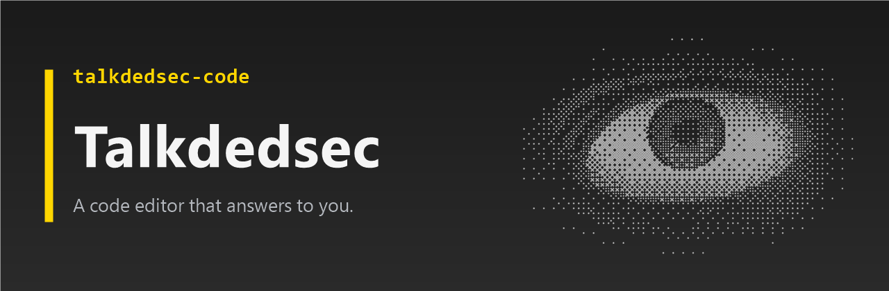
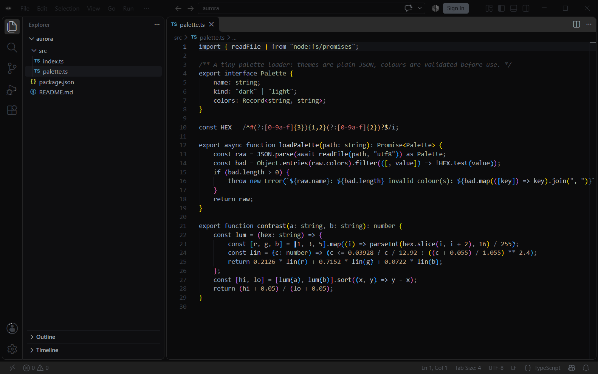
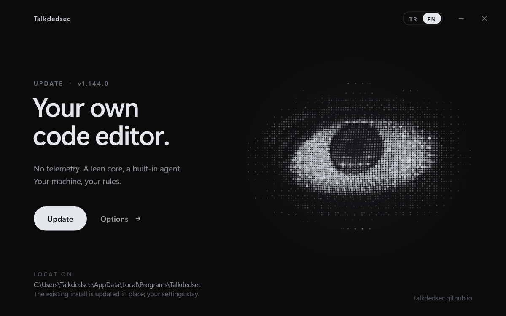

<p align="center">
  
</p>

<p align="center">
  <a href="https://github.com/Talkdedsec/talkdedsec-code/releases/latest"></a>
  <a href="LICENSE.txt"></a>
  
  <a href="https://talkdedsec.github.io/talkdedsec-code/"></a>
</p>

<p align="center"><b>English</b> · <a href="README.tr.md">Türkçe</a> · <a href="https://talkdedsec.com">talkdedsec.com</a></p>

**Talkdedsec** is a telemetry-free code editor for Windows, built on the open-source VS Code core. Same editor you know, without the data collection, with its own themes, a Turkish UI and an installer that feels like part of the product.

<p align="center">
  
</p>

## What is different

- **No telemetry by default.** Telemetry and experiments are off out of the box. The voice service, JSON schema downloads, npm package lookups and the chat plugin list no longer call out on their own.
- **Open VSX.** Extensions come from [open-vsx.org](https://open-vsx.org).
- **Five themes.** Talkdedsec Dark, Midnight, Matrix, Ember and Light. Chrome, panels, git decorations and the terminal turn together.
- **Turkish and English.** The Turkish language pack ships inside; Turkish Windows opens in Turkish, the product name is consistent in every string.
- **Lean package.** No bundled Copilot extension, no test extensions, no source maps.
- **Its own installer.** A native Direct2D window over a silent Inno Setup: the dotted eye follows the cursor and lights up as files land. No WebView, no runtime.

<p align="center">
  
</p>

## Install

1. Download `TalkdedsecSetup.exe` from the [latest release](https://github.com/Talkdedsec/talkdedsec-code/releases/latest).
2. Optionally check it: `Get-FileHash TalkdedsecSetup.exe -Algorithm SHA256` must match the release notes.
3. Run it. It installs per user to `%LOCALAPPDATA%\Programs\Talkdedsec`; no administrator rights needed.

The installer is not code-signed yet, so Windows SmartScreen may ask once: **More info → Run anyway**.

## Build from source

Requirements: Windows 10/11 x64, Node.js 24.22.1, Python 3, Visual Studio 2022 Build Tools with *Desktop development with C++* and *MSVC Spectre-mitigated libs*, Windows 10/11 SDK (for `signtool`).

```powershell
npm ci
$env:PATH = "${env:ProgramFiles(x86)}\Windows Kits\10\bin\10.0.26100.0\x64;$env:PATH"
npm run gulp vscode-win32-x64-min
npm run gulp vscode-win32-x64-inno-updater
npm run gulp vscode-win32-x64-user-setup
powershell -ExecutionPolicy Bypass -File tlk/kurulum/derle.ps1   # -> .build/win32-x64/TalkdedsecSetup.exe
```

## How the fork is kept

Upstream VS Code is imported as is; every change lives in two idempotent scripts, so a new upstream version is a re-import plus two commands:

| | |
|---|---|
| `node tlk/rebrand.mjs` | Name, identity, icons from `tlk/logo.png`, product name in UI strings |
| `node tlk/ozellestir.mjs` | Privacy defaults, Open VSX, themes, Turkish UI, installer bridge, repository files |
| `tlk/kurulum/` | The setup shell (C++, Direct2D/DirectWrite) |
| `site/` | The website, deployed to GitHub Pages |

## License

[MIT](LICENSE.txt). The VS Code source is © Microsoft Corporation; Talkdedsec's changes are © Talkdedsec. Talkdedsec is not affiliated with or endorsed by Microsoft; “Visual Studio Code” is a trademark of Microsoft.

## Security

Please do not open public issues for vulnerabilities. See [SECURITY.md](SECURITY.md).

---

<p align="center"><a href="https://talkdedsec.com">talkdedsec.com</a> · made by <a href="https://github.com/Talkdedsec">Talkdedsec</a></p>
